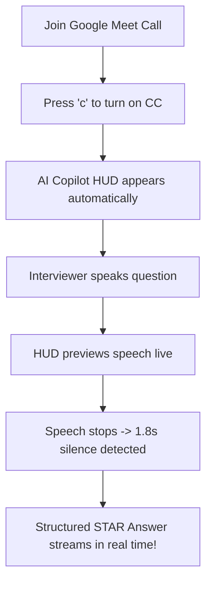

<h1 align="center">AI Interview Copilot — Complete User Guide</h1>

<p align="center">
  <strong>The definitive manual for setting up, personalizing, and mastering live interview assistance on Google Meet</strong>
</p>

<p align="center">
  
  
  
</p>

---

## 📑 Table of Contents
1. [Introduction & Core Philosophy](#1-introduction--core-philosophy)
2. [Installation Options](#2-installation-options)
   - [Option A: Install via Pre-built ZIP (Fastest)](#option-a-install-via-pre-built-zip-fastest)
   - [Option B: Build from Source Code (Developers)](#option-b-build-from-source-code-developers)
3. [Initial Setup: AI Model Configuration](#3-initial-setup-ai-model-configuration)
   - [Supported AI Providers & Recommended Models](#supported-ai-providers--recommended-models)
   - [Testing Your API Connectivity](#testing-your-api-connectivity)
4. [Interview Personalization: Resume & Context Grounding](#4-interview-personalization-resume--context-grounding)
   - [Writing an Effective Resume Summary](#writing-an-effective-resume-summary)
   - [Selecting Response Language & Style Tones](#selecting-response-language--style-tones)
5. [Pre-Interview Rehearsal: Google Meet Simulator](#5-pre-interview-rehearsal-google-meet-simulator)
6. [Live Call Execution: Real Google Meet Procedure](#6-live-call-execution-real-google-meet-procedure)
   - [Activating Closed Captions (Mandatory)](#activating-closed-captions-mandatory)
   - [How the Smart Debouncer Works](#how-the-smart-debouncer-works)
7. [Mastering the Floating HUD](#7-mastering-the-floating-hud)
   - [STAR Key Points vs. Full Speaking Script](#star-key-points-vs-full-speaking-script)
   - [Adjusting Widget Opacity & Position](#adjusting-widget-opacity--position)
8. [Keyboard Shortcuts & The Boss Key](#8-keyboard-shortcuts--the-boss-key)
9. [Keeping the Extension Updated (In-App Checker)](#9-keeping-the-extension-updated-in-app-checker)
10. [Privacy, Security & Interview Discretion](#10-privacy-security--interview-discretion)
11. [Troubleshooting & FAQ](#11-troubleshooting--faq)

---

## 1. Introduction & Core Philosophy

**AI Interview Copilot** is designed to be your discreet pair-programming partner during technical and behavioral online interviews. 

### Why It Excels:
- **Zero Audio Invasiveness**: Instead of requesting access to your system microphone (which video conferencing software or screen shares can flag), it reads Google Meet's native closed captions (`CC`) via `MutationObserver`.
- **Authentic Grounding**: It weaves facts from your actual resume and past projects into every response. You never sound like a generic textbook.
- **Translucent HUD**: Runs inside an isolated **Shadow DOM** with 85% opacity frosted glass, so you can read prompt suggestions while keeping natural eye contact with your interviewer.

---

## 2. Installation Options

### Option A: Install via Pre-built ZIP (Fastest)
*Recommended for most users — no programming tools or Node.js required.*

1. Go to the [GitHub Releases](https://github.com/rivaldiekaptrrr/interview-ext/releases) page.
2. Download the latest `ai-interview-copilot-vX.X.X.zip` (or `ai-interview-copilot-latest.zip`).
3. Extract (unzip) the file into a permanent folder on your computer (e.g. `Documents/ai-interview-copilot`).
4. In Google Chrome, navigate to:
   ```text
   chrome://extensions/
   ```
5. Turn **ON** the **Developer mode** toggle in the top-right corner.
6. Drag and drop the extracted folder directly into the Extensions window (or click **Load unpacked** and select the folder).
7. Click the **Puzzle icon** on your Chrome toolbar and **Pin 📌** the extension for easy access.

### Option B: Build from Source Code (Developers)
*For contributors who want to compile directly from source code.*

```bash
# 1. Clone the repository
git clone https://github.com/rivaldiekaptrrr/interview-ext.git
cd interview-ext

# 2. Install dependencies
npm install

# 3. Build the production package
npm run build
```

Then load the generated `dist/` folder via `chrome://extensions/` ➔ **Load unpacked**.

---

## 3. Initial Setup: AI Model Configuration

Click the extension icon in your Chrome toolbar to open the **Popup Settings** window.

### Supported AI Providers & Recommended Models

| Provider | Recommended Model | Why Choose This |
| :--- | :--- | :--- |
| **Google Gemini** | `gemini-2.5-flash` or `gemini-2.0-flash` | **Fastest response latency**, generous free tier, outstanding reasoning. |
| **OpenAI** | `gpt-4o` or `gpt-4o-mini` | Benchmark coding abilities, extremely reliable structured answers. |
| **Anthropic Claude** | `claude-3-5-sonnet` | Natural human conversational cadence and nuanced architectural depth. |
| **Custom / Local AI** | Ollama (`llama3.2`, `deepseek-r1`), Groq, OpenRouter | 100% offline local privacy or ultra-fast hosted open-weights inference. |

### Testing Your API Connectivity
1. Paste your API Key in the **API Key** input box.
2. Click **Test Connection**.
3. A latency indicator will display in green (e.g., `✓ Connected (230ms)`).
4. Click **Save Settings**.

> [!TIP]
> Your API key is stored strictly on your local machine via Chrome's encrypted `chrome.storage.local`. It is never transmitted to any server other than your selected AI provider.

---

## 4. Interview Personalization: Resume & Context Grounding

Under the **Resume & Context** tab, provide the AI with your personal background so it can customize every answer.

### Writing an Effective Resume Summary
Instead of pasting a 10-page CV, provide high-impact bullet points:
```text
- Senior Fullstack Engineer with 5 years experience in React, TypeScript, Go, and PostgreSQL.
- Architected a distributed messaging pipeline handling 40,000 requests/sec with Redis & Kafka.
- Led migration of a monolith into microservices, decreasing release cycle times by 60%.
- Core strengths: Distributed systems, web performance optimization, and engineering leadership.
```

### Selecting Response Language & Style Tones
- **AI Response Language**:
  - `Auto`: Detects and matches the interviewer's language.
  - `English`: Always answers in English.
  - `Bahasa Indonesia`: Always answers in Bahasa Indonesia.
- **Answer Tone & Style**:
  - **STAR Method**: Best for behavioral questions (*Situation, Task, Action, Result*).
  - **Concise & Direct**: Best for rapid-fire technical questions (*Key facts first, zero fluff*).
  - **Deep Technical**: Best for senior/lead system design questions (*Trade-offs, bottlenecks, architecture*).

---

## 5. Pre-Interview Rehearsal: Google Meet Simulator

Never test an extension for the first time during an actual interview. Use the built-in **End-to-End Google Meet Simulator**:

1. Open the extension popup and click **"Open Meet Simulator"** in the top banner.
2. A replica Google Meet conference room will launch.
3. Click **"Scenarios & Context"** on the top pill bar to open the testing drawer.
4. Click **"Play Question 1"** (Behavioral) or **"Play Question 2"** (Deep Technical).
5. Watch the interviewer speak with synthetic voice audio while live closed captions stream at the bottom of the screen.
6. The **Floating HUD Widget** will automatically detect silence and stream structured answers in real time!

---

## 6. Live Call Execution: Real Google Meet Procedure

When your real interview begins, follow this simple checklist:



### Activating Closed Captions (Mandatory)
The extension reads interview questions through Google Meet captions:
- Press the keyboard shortcut: **`c`**
- Or click the **[CC]** button in the Google Meet bottom call bar.

### How the Smart Debouncer Works
When an interviewer speaks, they might pause briefly to take a breath. The **Smart Debouncer** waits for **1.8 seconds of complete silence** before concluding that the question is finished. Once detected, it automatically triggers the AI response stream.

> [!NOTE]
> If you don't want to wait 1.8 seconds, press **`Alt + J`** to immediately force the AI to answer.

---

## 7. Mastering the Floating HUD

The HUD is designed to blend seamlessly into your screen:

```text
┌────────────────────────────────────────────────────────┐
│  [● Live]  "Can you describe your experience with..."   │
├────────────────────────────────────────────────────────┤
│  🎯 Key STAR Bullets                                   │
│  • Situation: Scaling a legacy payment service.        │
│  • Action: Implemented circuit breakers with Redis.   │
│  • Result: 99.99% uptime during Black Friday rush.     │
├────────────────────────────────────────────────────────┤
│  ▸ Expand Full Speaking Script (Natural Voice)         │
└────────────────────────────────────────────────────────┘
```

- **Dual-Layer Card**:
  - **Bullet Points**: Glanced in 3 seconds to guide your natural speech.
  - **Full Script**: Click to expand for a complete sentence-by-sentence narrative.
- **Draggable**: Click and hold the header bar to drag the HUD anywhere on your monitor.
- **Resizable**: Drag the bottom-right corner to make the HUD wider or taller.
- **85% Translucency**: Ensures text behind the HUD remains subtly visible.

---

## 8. Keyboard Shortcuts & The Boss Key

| Shortcut | Function | Practical Use Case |
| :--- | :--- | :--- |
| **`Alt + H`** | **Boss Key (Toggle HUD)** | **Critical**: Instantly hides/reveals the widget when you are asked to share your screen. |
| **`Alt + J`** | **Answer Now** | Manually triggers the AI answer without waiting for the silence pause. |
| **`c`** | **Toggle Google Meet CC** | Native Google Meet shortcut to turn captions on/off. |

---

## 9. Keeping the Extension Updated (In-App Checker)

The extension includes a built-in update detector:
- **Automatic Check**: When opening the popup, it quietly checks GitHub Releases for new versions.
- **Minimalist Update Banner**: If a newer version is released, a subtle card appears:
  ```text
  [NEW UPDATE] v1.0.3 is available
  [Download ZIP]  [×]
  ```
- **Manual Check**: You can click the version pill (e.g. `v1.0.2`) in the popup header anytime to verify your installation status.

### Updating Your Unpacked Extension:
1. Click **Download ZIP** on the update banner.
2. Extract the downloaded zip file.
3. Replace the contents of your existing extension folder.
4. Open `chrome://extensions/` and click the **Reload 🔄** icon on AI Interview Copilot.

---

## 10. Privacy, Security & Interview Discretion

- **No Remote Proxies**: All LLM requests are sent directly from your browser to your configured AI provider endpoint.
- **No Background Telemetry**: Zero analytics, zero logging, and zero tracking cookies.
- **Screen Share Safety**: Before sharing your screen, always press **`Alt + H`** to hide the floating widget. When screen sharing, select **"A Window"** or **"A Tab"** instead of "Entire Screen" to keep the HUD invisible.

---

## 11. Troubleshooting & FAQ

#### Q: The floating widget does not appear in Google Meet.
1. Ensure Closed Captions are turned **ON** in Google Meet (press `c`).
2. Refresh the Google Meet tab.
3. Ensure the extension is enabled in `chrome://extensions/`.

#### Q: The AI answers with generic responses instead of my resume facts.
Open the extension popup ➔ **Resume & Context** tab ➔ ensure you clicked **"Save Context"** after pasting your resume.

#### Q: I get a connection error when testing API Key.
1. Verify you have active API credits with your provider (OpenAI, Gemini, Anthropic).
2. Check that your network or VPN does not block the provider's API endpoint.

---

<p align="center">
  <em>Good luck with your interviews! You've got this. 🚀</em>
</p>
